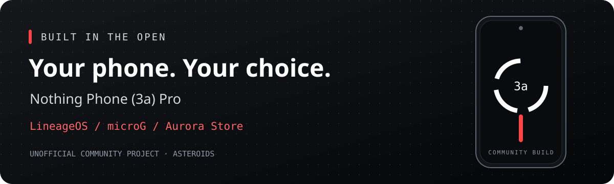

<p align="center"></p>

# Nothing Phone (3a) Pro — LineageOS, microG & Aurora

[](https://github.com/YZUe1980/nothing-phone-3a-pro-lineageos-google-free-aurora/actions/workflows/validate.yml)

**Your phone. Your apps. Your choice.**

[Deutsch](README.md) · [Build guide](docs/BUILD.md) · [Device status](docs/STATUS.md) · [Contribute](CONTRIBUTING.md)

An open development project for an unofficial **LineageOS 23.2** build for the **Nothing Phone (3a) Pro**, combining **microG**, **F-Droid** and **Aurora Store**. We publish the build recipe, source revisions and test results so others can inspect the work and help improve it.

**Development preview — the first build and device validation are still in progress. No tested ROM release is available yet.**

## What we are building

| Component | Plan |
| --- | --- |
| Device | Nothing Phone (3a) Pro, A059P, `asteroids` |
| Android | LineageOS 23.2 with the device maintainer's Linux 6.6 trees |
| Compatibility | microG in place of bundled proprietary Google Play Services |
| Apps | F-Droid and Aurora Store included in the build configuration |
| Root | Optional Magisk; validated separately after an unmodified first boot |
| Development | Public manifests, scripts, findings and issue tracking |

## “Google free” — with a clear meaning

The goal is a phone without preinstalled proprietary Google Play Services and Google apps. That does **not** mean every possible Google connection disappears: Aurora Store accesses Google Play, and optional microG features can connect to Google. Network defaults and remaining dependencies are part of the work we document.

The build also needs proprietary hardware support files. **This repository is open source; the entire firmware stack is not.** It contains build configuration and links to upstream sources, rather than firmware archives, APKs or private signing keys.

## Follow the work

1. Build and inspect the ROM artifacts.
2. Validate installation on the A059P test device, including the kernel 6.1 → 6.6 transition.
3. Test boot, radio, calls, cameras, connectivity, microG and optional root.
4. Publish the results and a verified installation procedure before a tested release.

The [status page](docs/STATUS.md) separates completed preparation from checks that have not run yet. A successful compilation alone does not establish device compatibility.

## Build it

```bash
git clone https://github.com/YZUe1980/nothing-phone-3a-pro-lineageos-google-free-aurora.git
cd nothing-phone-3a-pro-lineageos-google-free-aurora
./scripts/build.sh --dry-run
./scripts/build.sh
```

Read the [build guide](docs/BUILD.md) first for hardware requirements, source modes and signing-key storage. The default uses the recorded source snapshot; a tracking mode follows upstream branches. The new wrapper itself is under development and has not yet completed a fresh end-to-end build.

## Help shape the project

Useful contributions include reviewing device changes, documenting reproducible failures, checking microG integration, improving translations and testing clearly identified builds. Start with [CONTRIBUTING.md](CONTRIBUTING.md). Please use GitHub issues for this project's work and include the exact build revision with reports.

## Credits and licensing

This project builds on [LineageOS](https://github.com/LineageOS), [NullDebris's device and kernel work](https://github.com/NullDebris), [LineageOS for microG's build tooling](https://github.com/lineageos4microg/docker-lineage-cicd), [microG](https://microg.org/), [F-Droid](https://f-droid.org/), [Aurora Store](https://gitlab.com/AuroraOSS/AuroraStore) and [Magisk](https://github.com/topjohnwu/Magisk). The original device-tree contributors retain their credits in the upstream sources.

New scripts and documentation in this repository are licensed under [Apache-2.0](LICENSE). Upstream software and proprietary hardware files retain their own licenses; see [third-party notes](docs/THIRD_PARTY.md). This is an independent community project, unaffiliated with Nothing or the LineageOS project.

GitHub Actions validates scripts and manifests on changes. The full Android build currently runs on the development machine. [CI details](docs/CI.md).
